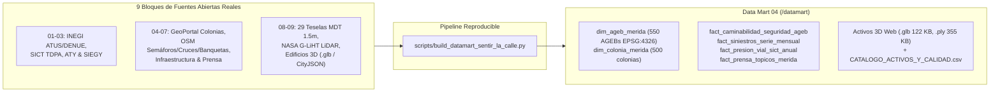

# Data Storytelling & Data Mart 04: Sentir la Calle
### *Seguridad vial, accesibilidad e infraestructura peatonal en Mérida, Yucatán*

> 🌐 **Plataforma Web Interactiva (GitHub Pages):**  
> 👉 **[https://rivaldo2309030.github.io/Visual-Modeling-For-Information/](https://rivaldo2309030.github.io/Visual-Modeling-For-Information/)**  
> 📦 **Data Mart 04 (Listo para Supabase / PostGIS & BI):** [`datamart/`](datamart/README.md)  
> 📋 **Catálogo de Activos y Calidad (29 archivos verificados con SHA-256):** [`datamart/CATALOGO_ACTIVOS_Y_CALIDAD.csv`](datamart/CATALOGO_ACTIVOS_Y_CALIDAD.csv)

---

## 🌟 Resumen Ejecutivo y Estado de Datos Reales

Este repositorio consolida las fuentes abiertas, capas geoespaciales (`EPSG:4326`), activos 3D (`.ply`, `.glb`, `CityJSON v2.0`), scripts ETL reproducibles y el **Data Mart 04** del Equipo 4 (*Rivaldo, Elisabeth y Christopher*).

Todos los archivos de prueba (`sample_*`) fueron eliminados y sustituidos por **29 activos de datos 100% reales y trazables** (~6.8 MB curados en total), homologados sobre la llave territorial oficial del grupo (**550 AGEBs de Mérida — Marco Geoestadístico INEGI dic 2025** y **500 colonias del GeoPortal Municipal**):

| Subtema | Carpeta | Activos Reales Integrados | Volumen Verificado |
| :---: | :--- | :--- | :--- |
| **01** | [`data/01_inegi_denue/`](data/01_inegi_denue) | Siniestros viales ATUS Mérida (2021–2024), incidentes peatonales/ciclistas y exposición comercial DENUE + Censo 2020 por AGEB | **8,815** accidentes totales · **501** peatón/ciclista · **56,908** comercios DENUE |
| **02** | [`data/02_datos_gob/`](data/02_datos_gob) | Serie histórica de Tránsito Diario Promedio Anual (TDPA) y mezcla vehicular SICT/IMT en accesos a Mérida vs. Yucatán | **4,169** aforos (2013–2024) · **277** estaciones georreferenciadas |
| **03** | [`data/03_siegy_yucatan/`](data/03_siegy_yucatan) | Catálogo oficial de rutas ATY (Va-y-Ven e IE-TRAM), red espacial de paraderos e indicadores SIEGY | **110** rutas oficiales ATY · **565** trazas/paraderos GIS · **6** indicadores SIEGY |
| **04** | [`data/04_geoportal_merida/`](data/04_geoportal_merida) | Polígonos oficiales de colonias, Centro Histórico, zonas patrimoniales y nodos reales semaforizados en Mérida | **500** colonias · **74** zonas patrimoniales · **190** semáforos reales (`OSM`) |
| **05** | [`data/05_transparencia_pnt/`](data/05_transparencia_pnt) | Infraestructura pública abierta: luminarias, bancas y refugios peatonales, catálogo de capas SIG de Obras Públicas y serie urbana municipal *(sin solicitudes PAE/PNT)* | **562** elementos de mobiliario/alumbrado · **66** capas SIG Obras Públicas |
| **06** | [`data/06_web_scraping/`](data/06_web_scraping) | Corpus hemerográfico real (*Diario de Yucatán*, *Novedades Yucatán*, *Sala de Prensa* y RSS local) y red de co-ocurrencia | **338** notas periodísticas únicas · **26** relaciones semánticas |
| **07** | [`data/07_self_produced_upy/`](data/07_self_produced_upy) | Red peatonal real (banquetas, andadores y escaleras) y cruces peatonales con atributos de accesibilidad en Mérida (`OpenStreetMap`) | **4,092** cruces peatonales · **9,857** tramos (**697.6 km** de red peatonal) |
| **08** | [`data/08_lidar_3d/`](data/08_lidar_3d) | Estadísticas zonales reales de elevación y pendiente sobre **29 teselas INEGI MDT 1.5 m**, nube `.ply` del Centro Histórico y huellas LiDAR aéreo **NASA G-LiHT 2013** | **550/550** AGEBs con elevación/pendiente · **11,554** pts `.ply` · **369** polígonos G-LiHT |
| **09** | [`data/09_realidad_aumentada_ar/`](data/09_realidad_aumentada_ar) | Modelo urbano 3D real del Centro Histórico de Mérida extruido desde huellas OSM sobre cotas INEGI 1.5 m en `.glb` y `CityJSON v2.0` + benchmark `cityjson.org` | **105** edificios reales en `.glb` (**121.8 KB**) y `CityJSON v2.0` |

---

## 🏗️ Arquitectura de Integración al Data Warehouse (Supabase / PostGIS)



---

## ⚙️ Reproducibilidad

Para regenerar todas las capas limpias, métricas espaciales, archivos 3D y tablas del Data Mart:

```bash
python scripts/build_datamart_sentir_la_calle.py
```

Las especificaciones de las 27 URLs originales entregadas en la Semana 1 se conservan intactas en [`ENTREGABLE_SEMANA_1_FUENTES.md`](ENTREGABLE_SEMANA_1_FUENTES.md).

---

## 👥 Equipo y Responsabilidades

| Integrante | Subtemas en Equipo 4 | Rol Transversal Final |
| :--- | :--- | :--- |
| **Rivaldo** | 05 (Infraestructura Municipal), 08 (Elevación/LiDAR 3D), 09 (Modelos 3D `.glb` / CityJSON) | **Spatial Data Team** (LiDAR, Modelos 3D y Capas Espaciales) |
| **Elisabeth** | 01 (INEGI ATUS/DENUE/Censo), 02 (SICT/IMT), 03 (ATY Va-y-Ven & SIEGY) | **Spatial Data Team** (Extracción Documental/PDFs y Validación) |
| **Christopher** | 04 (GeoPortal & Semáforos OSM), 06 (Scraping Prensa), 07 (Red Peatonal & Cruces OSM) | **Structured Data Team** ( Tablas Bronze/Silver/Gold y ETL ) |
